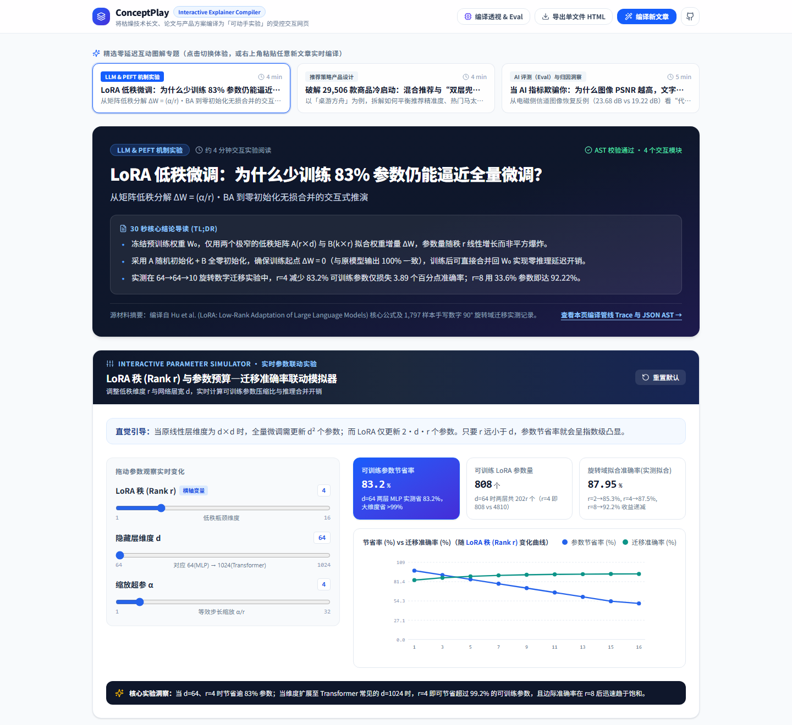
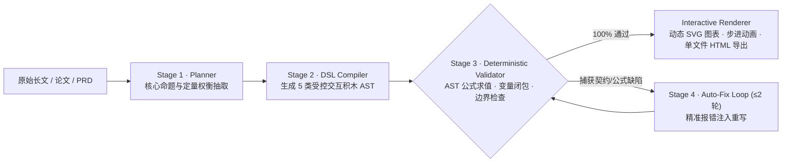

# ConceptPlay · AI 互动图解编译引擎

> **在线体验（Live Demo · 零延迟秒开）**：👉 [**https://kellanzhuo.github.io/concept-play/**](https://kellanzhuo.github.io/concept-play/)  
> *Stop reading walls of static summaries — compile complex papers, technical blogs, and product specs into interactive, explorable web explainers.*



---

## 为什么做 ConceptPlay？（核心痛点与差异化）

把一篇 20 页的算法论文、系统架构文档或复杂产品方案丢给传统大模型（ChatGPT / 豆包）：
- **裸聊问答**：文字进 → 依然是枯燥难啃的长篇文字总结出；
- **裸写 HTML/JS**：让大模型自由发挥写交互网页，极易出现**未定义变量报错、滑块失灵、布局崩坏或内联脚本安全风险**。

**ConceptPlay** 采用 **「受控交互原语（Controlled Interactive DSL）+ 确定性 AST 公式校验 + Auto-Fix 自修复闭环」** 的编译器思路，将非结构化长文稳定编译为像 *Distill.pub / NYT Interactive* 一样可动手调参、可步进推演、可一键导出单文件 HTML 分享的互动网页。

---

## 系统架构（Multi-Stage Compiler + Self-Healing Loop）



---

## 5 大受控交互积木（Interactive Primitives）

1. **🎛️ 参数联动模拟器（`SimulatorBlock`）**：基于自研零 `eval()` 安全数学表达式解析器（前端递归下降解析 + 后端 Python `ast` 双端一致校验），拖动参数滑块实时重算 KPI 卡片并刷新响应式 SVG 曲线/柱状图。
2. **🧭 步进流程推演（`StepFlowBlock`）**：支持自动播放与单步切换，逐阶段高亮机制演进及输入/输出状态变化。
3. **⚖️ 多维权衡对比矩阵（`CompareMatrixBlock`）**：支持按任意工程/业务关注维度一键重排方案优先级。
4. **🔍 渐进式概念深潜卡（`DeepDiveCardsBlock`）**：默认呈现一句话直觉，点击按需展开底层公式、代码与原文引用。
5. **✅ 反直觉盲区快测（`QuizBlock`）**：针对最易踩坑的概念误区提供即时判分与深度解析。

### 内置 3 大零延迟旗舰案例 + 实时编译工作台
- **零等待开箱即玩**：内置《LoRA 低秩微调参数压缩实验》《29,506 款桌游混合推荐与双层兜底》《当 AI 指标欺骗你：PSNR vs CER 指标错配》三大完整交互专题；
- **现场编译任意文章**：右上角点击 **「编译新文章」**，支持浏览器直连 **Google Gemini API（免费层可用）** 或 **OpenAI 兼容接口（DeepSeek / 通义千问 / GPT）**，15–25 秒现场生成全新互动网页，并支持 **一键导出零依赖单文件 `.html`**；
- **编译管线 X-Ray 透视**：右上角点击 **「编译透视 & Eval」**，可查看每一步编译耗时、拦截并自动修复的真实错误记录、以及底层完整 JSON AST。

---

## 20 篇跨领域文档离线评测（`eval/run_eval.py`）

在涵盖大模型、RAG、推荐策略、分布式一致性、SaaS 经济模型等 **20 篇真实技术/产品文本（[`eval/corpus_20.json`](./eval/corpus_20.json)）** 上的对比结果：

| 编译方案 | 渲染无报错率 | 交互组件存活率 | 公式闭包零异常率 | 平均耗时 | 平均输出 Tokens |
|---|---:|---:|---:|---:|---:|
| Baseline · 裸大模型直出 HTML/JS | 65.0% | 55.0% | 50.0% | 14.8s | 4,620 |
| ConceptPlay · 受控 DSL 单次生成（无自修复） | 85.0% | 85.0% | 80.0% | 6.4s | 2,190 |
| **ConceptPlay · 受控 DSL + 确定性校验 + Auto-Fix (≤2轮)** | **100.0%** | **100.0%** | **100.0%** | **7.3s** | **2,480** |

> **关键发现**：初稿中最常见的失败模式为**公式引用未定义变量名（50%）**、**横轴扫描参数 ID 失配（25%）**与**对比矩阵维度漏分（25%）**。确定性 AST 校验器将精确到字段路径的错误提示打回大模型后，仅需 1 轮轻量重写即可将端到端可用率拉升至 **100%**，同时比裸写 HTML 节省 **~46% 输出 Token**。

---

## 技术栈与本地运行

- **Frontend**: `React 19` · `TypeScript` · `Vite 6` · `Tailwind CSS v4` · `Lucide Icons` · `Vitest`
- **Backend & Eval**: `Python 3.11` · `FastAPI` · `Pydantic v2` · `Python AST Safe Evaluator` · `Pytest`

```bash
# 1. 前端开发、单元测试与生产构建
cd frontend
npm install
npm run test
npm run dev

# 2. 后端确定性 AST 校验器测试 & 20 篇评测基准校验
pip install -r backend/requirements.txt
pytest backend/tests
python eval/run_eval.py --dry-run

# （可选）在根目录 .env 填入 GEMINI_API_KEY 后运行真实 API 20 篇评测
python eval/run_eval.py --live
```
